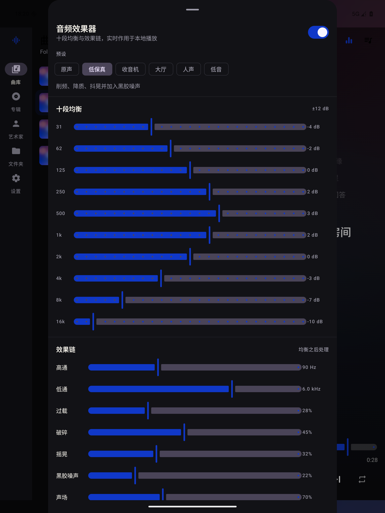
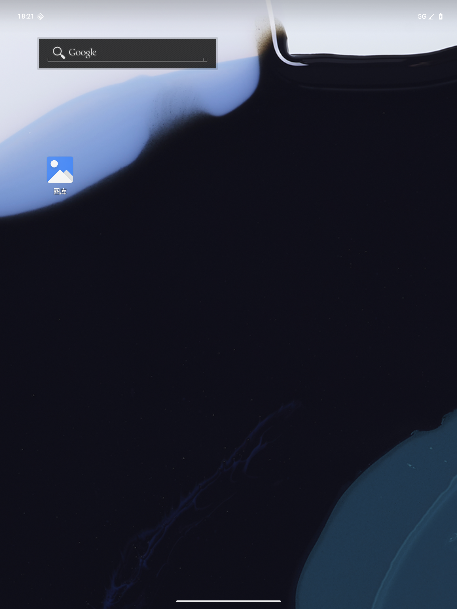

# Folia Local

**Lyrics Reimagined // 辞曲新境 — Android 本地版**

Folia Local 是 [chthollyphile/folia-major](https://github.com/chthollyphile/folia-major) 的 **Android 原生重制项目**。
它保留了原项目「全屏沉浸式歌词」的核心体验与视觉语言，并把产品范围收敛为一件事：

> 只播放你自己的本地音乐文件夹。没有账号，没有云端，没有在线播放。

- 原生 Android（Kotlin + Jetpack Compose + Media3），不是 WebView / Capacitor 套壳。
- 本地音乐通过 Android Storage Access Framework（SAF）读取。
- **唯一联网能力是手动下载歌词**（lrclib.net 公共免费接口，无需账号密钥），不访问任何音乐服务。
- 界面完整本地化，中文 / English 随系统语言切换。
- 针对手机、平板与折叠屏分别布局。

> 本仓库不是 Folia 官方 Android 客户端，也不代表原项目的移动端计划。原项目仍然是桌面/Web 端的主线。

---

## 与原项目的关系

| 项目 | 说明 |
| --- | --- |
| 原项目 | [chthollyphile/folia-major](https://github.com/chthollyphile/folia-major) |
| 原项目许可证 | AGPL-3.0 |
| 本项目定位 | Android 原生重制，纯本地、离线优先 |
| 复用的内容 | 产品概念、全屏歌词体验、歌词样式命名（流光 / 浮名 / 倾诉）、本地曲库的数据组织方式、配色与视觉基调 |
| 未复用的内容 | Electron 主进程、Web 前端代码、在线音乐 Provider、AI 主题生成、同步服务端、OBS / Stage / 远程控制等 |

原项目的能力介绍、桌面版下载与完整文档请访问：

- [Folia 主仓库](https://github.com/chthollyphile/folia-major)
- [Folia Releases](https://github.com/chthollyphile/folia-major/releases)
- [Folia 使用指南](https://folia-site.cielaniska.top/guide/)

---

## 已移除的云端能力

本项目在架构层面移除了原项目的所有在线/云服务，而不是仅隐藏入口：

| 原能力 | 本项目 |
| --- | --- |
| 网易云 / QQ 音乐 / 酷狗 / Spotify / YouTube Music / 波点音乐 | 移除，在线 Provider 与相关登录、搜索、播放接口一律不存在 |
| Navidrome | 移除 |
| AI 主题生成、歌词代理 | 移除 |
| Sync Server / 跨设备同步 | 移除 |
| OBS、Stage API、远程控制、模歌词系统 | 移除 |
| Electron 桌面端、Docker、Vercel/Cloudflare 部署 | 移除 |

由此带来的结果：

- 在线音乐播放、账号系统、遥测、广告 SDK 一概不存在。
- 唯一的 HTTP 调用是「手动下载歌词」时访问 [lrclib.net](https://lrclib.net) 公共接口（见下文），使用系统自带的 `HttpURLConnection`，无第三方网络库。
- 曲库索引、封面缓存、歌词与设置均保存在应用私有目录。
- 删除应用数据即可彻底清除本应用产生的全部数据。

---

## 功能

### 本地曲库

- 通过 SAF 选择一个音乐根目录，递归扫描子文件夹。
- 支持 `mp3`、`flac`、`m4a`、`aac`、`wav`、`ogg`、`opus`。
- 读取音频元数据（标题、艺术家、专辑、音轨号、年份、时长）。
- 元数据缺失时，从文件名回退解析（支持 `艺术家 - 标题` 与音轨号前缀）。
- 按歌曲 / 专辑 / 艺术家 / 文件夹聚合。
- 本地搜索：歌名、艺术家、专辑、文件名。
- 随时重新扫描、更换文件夹或清空索引。

### 曲目信息编辑

- 每首歌曲都可以修改**标题、艺术家、专辑与封面**：曲库列表行、迷你播放条与播放页都有编辑入口，专辑页与艺术家页同样可用。
- 修改不会改动音频文件本身：标题 / 艺术家 / 专辑 / 自定义封面保存在应用私有目录的覆盖表中，重新扫描后依然生效，专辑与艺术家页会随之重新聚合。
- 自定义封面会缩放后复制到应用私有目录，支持从系统相册选图，也可一键移除恢复默认。
- 若歌曲带同名 `.lrc`，歌词头部标签（`[ti:]`、`[ar:]`、`[al:]`、`[by:]`、`[offset:]`）会在同一对话框中直接写回原文件（需要文件夹的写权限，首次编辑时会自动升级授权）。

### 歌词

- 自动读取与音频**同名的 `.lrc` / `.txt`** 歌词文件。
- 支持标准 LRC：
  - `[mm:ss]`、`[mm:ss.xx]`、`[mm:ss.xxx]`
  - 一行多个时间标签
  - `[offset:±ms]`
- 支持增强型逐字 LRC：`<mm:ss.xx>逐字<mm:ss.xx>时间轴`。
- 没有逐字时间轴时，会按字符/词长度把整行时长均匀分配，得到卡拉 OK 式点亮效果。
- UTF-8 / UTF-16 BOM 自动识别；失败时回退 GB18030，兼容常见 GBK 歌词。
- 点击任意歌词行可跳转到该句。
- **在线下载歌词**：没有本地歌词时，可点击播放页的下载按钮，从 [lrclib.net](https://lrclib.net) 公共免费接口按「曲名 + 艺术家」搜索（可改关键词），选中带时间轴的结果后，会以 `application/octet-stream` 写成与音频同名的 `.lrc` 文件保存到原目录，并立即刷新当前歌词。此操作是唯一触发网络请求的路径，仅使用系统自带 `HttpURLConnection`，不上传任何数据。
- 长间奏处理：当前句结束后超过 3.2 秒仍无下一句（例如后接纯音乐）时，歌词会自然淡出，避免一句停留半分钟。

### 十种沉浸式歌词样式

| 样式 | 特点 |
| --- | --- |
| **流光 Lumi** | 居中大字，当前行逐字点亮并带有光晕，上下行淡出 |
| **浮名 Fume** | 疏松行距与更安静的排版，适合阅读长句 |
| **心象 Cad** | 冷色光晕氛围排版 |
| **云阶 Pat** | 柔和高亮层级 |
| **群唱 Cappella** | 多行合唱式排布 |
| **倾诉 Tilt** | 左对齐叙事排版，当前行有强调色竖线，像一封手写信 |
| **镜台 Diorama** | 层次景深式的舞台排版 |
| **时计 Pendolo** | 节拍感的时间轴排版 |
| **声谱 Spectrum** | 频谱气质的行间律动 |
| **封面 Cover** | 模糊封面为底 + **完整歌词列表**：展示全部歌词行、高亮当前句（无逐字跳出），当前句及任意行均可点击跳转 |

- 除封面样式逐字点亮的样式外，其余样式的当前句不做逐字动画；所有样式都支持点击歌词行跳转。
- 长句间奏时当前句自动淡出（见上文）。
- 样式选择采用紧凑网格：设置页与播放页样式面板同一套 3 列格子，选中样式下方展示其描述，不再占用半屏。
- 字号可在 75% – 150% 之间调整；强调色可跟随当前封面自动提取，也可固定为默认薰衣草色。

### 播放

- Media3 ExoPlayer 解码，`MediaSessionService` 后台播放。
- 通知栏 / 锁屏 / 蓝牙耳机控制。
- 播放队列、随机播放、单曲循环 / 列表循环。
- 音频焦点处理、耳机拔出自动暂停。
- 封面、标题与艺术家信息同步到媒体通知。
- 播放 / 暂停带 200ms 淡入淡出，避免切歌与暂停时的爆音。

### 音频效果器（对齐原项目）

原项目最特别的播放能力是一整套实时音频效果器，本项目在 Media3 的 PCM 管线上用原生 Kotlin DSP 重新实现，而不是调用系统音效或网络服务。



- **六套预设**：原声、低保真、收音机、大厅、人声、低音。曲线与效果值来自原项目 `audioPresets.ts`。
- **十段均衡**：31 / 62 / 125 / 250 / 500 / 1k / 2k / 4k / 8k / 16k Hz，±12 dB；首尾为低架 / 高架，中间为 Q=1.4 的峰值滤波器。
- **九级效果链**（均衡之后处理）：
  - 高通 20–2000 Hz、低通 500–20 kHz
  - 过载：带响度补偿的 tanh 软饱和
  - 破碎：16 bit → 约 4 bit 的幅度量化
  - 摇晃：12ms 基础延迟 + 0.7Hz wow 4.5ms + 6.8Hz flutter 0.6ms
  - 黑胶噪声：2600Hz 带通 + 稀疏爆裂声与底噪
  - 声场：0–200% 的中/侧立体声宽度
  - 空间：并联混响，湿声与干声按原比例混合
  - 冲击：阈值 −6 ~ −32 dB、压缩比 1:1 ~ 8:1 的动态压缩与补偿增益
- 开关、预设、推子都实时生效：音频线程每个缓冲区读取最新设置，无需重新 prepare。
- 关闭开关即完全直通；当前设置保存在本地 SharedPreferences。
- DSP 为纯 Kotlin 实现，并配有单元测试覆盖滤波、量化、声场、混响、压缩与噪声。

### 封面

- 优先读取同目录同名图片（`.jpg/.jpeg/.png/.webp`）。
- 其次读取文件夹级 `cover.jpg` 等。
- 再回退到音频内嵌封面。
- 都没有时，用曲目 ID 生成稳定的渐变占位图。
- 封面颜色用于播放页背景与强调色。

---

## 折叠屏与大屏适配

适配逻辑集中在 [`ui/adaptive`](app/src/main/java/dev/folialocal/app/ui/adaptive) 与 [`ui/FoliaApp.kt`](app/src/main/java/dev/folialocal/app/ui/FoliaApp.kt)。

| 窗口宽度 | 布局 |
| --- | --- |
| `< 600dp`（Compact） | 底部导航 + 迷你播放条，播放页全屏展开 |
| `600–839dp`（Medium） | 左侧 `NavigationRail`，内容单栏 |
| `≥ 840dp`（Expanded） | 曲库双栏：左侧浏览，右侧常驻「正在播放 + 歌词」面板 |



折叠屏额外处理：

- 使用 `androidx.window` 的 `WindowInfoTracker` / `FoldingFeature` 读取铰链姿态。
- **竖直分离式铰链**：双栏按铰链位置拆成两页，中间插入与铰链等宽的间隔，内容不会压在折痕上。
- **水平铰链（桌面模式）**：播放页在歌词区与控制区之间插入铰链高度的间隔。
- `MainActivity` 声明 `resizeableActivity` 并接管 `screenSize` / `smallestScreenSize` 等配置变化，展开、折叠、分屏时不会重建 Activity。
- 曲面/挖孔安全区通过 `WindowInsets.safeDrawing` 处理。

---

## 构建

### 环境

- JDK 17 或 21
- Android SDK Platform 36、Build-Tools 36
- Android Studio（推荐）或命令行 Gradle

### 命令行

```bash
# Debug APK
./gradlew assembleDebug

# 已签名 Release APK（读取本地 keystore.properties）
./gradlew assembleRelease

# 单元测试（LRC 解析、编码探测、音频 DSP）
./gradlew testDebugUnitTest
```

产物：

```text
app/build/outputs/apk/debug/app-debug.apk
app/build/outputs/apk/release/app-release.apk
```

安装：

```bash
adb install -r app/build/outputs/apk/debug/app-debug.apk
```

### Release 签名

Release 签名信息从项目根目录的 `keystore.properties` 读取：

```properties
storeFile=未命名.jks
storePassword=...
keyAlias=key0
keyPassword=...
```

`未命名.jks` 与 `keystore.properties` 都已被 `.gitignore` 忽略，**只保存在本地，不会提交或同步**。缺少这两个文件时，`assembleRelease` 仍可完成，但产物是未签名 APK，适合只做编译检查的 CI。

验证签名：

```bash
apksigner verify --print-certs app/build/outputs/apk/release/app-release.apk
```

### 技术栈

- Kotlin 2.2 / Jetpack Compose（Material 3）
- Media3 ExoPlayer + MediaSession
- 自定义 Media3 `AudioProcessor` + Kotlin DSP（十段均衡与效果链）
- AndroidX Window（折叠屏姿态）
- SAF + DocumentFile（本地目录）
- kotlinx.coroutines / kotlinx.serialization
- Palette（封面取色）

---

## 使用方式

1. 首次启动点击「选择音乐文件夹」，在系统文件选择器中授权一个目录。
2. 把音频文件放入该目录（可以是多层子文件夹）。
3. 如需歌词，把同名 `.lrc` 放在音频旁边：
   ```text
   Music/
   ├── Album/
   │   ├── 01 - 歌名.flac
   │   ├── 01 - 歌名.lrc
   │   └── cover.jpg
   ```
4. 新增或修改文件后，在「设置 → 曲库 → 重新扫描」或曲库页右上角刷新。
5. 某首歌没有歌词？在播放页点击下载图标，从 lrclib.net 搜索并保存 `.lrc` 到原目录。
6. 想修正曲库里的错别字、统一艺术家名或换封面？列表行 / 播放页的编辑按钮即可修改，不改动音频文件。

应用只保存 SAF 持久化读写权限，不申请存储读写权限，也不会复制或上传音乐文件。界面提供中文与 English 两套文案，跟随系统语言。

---

## 目录结构

```text
app/src/main/java/dev/folialocal/app/
├── FoliaApplication.kt          # 手动依赖容器
├── MainActivity.kt              # 单 Activity + edge-to-edge
├── data/
│   ├── library/                 # SAF 扫描、索引持久化、封面加载
│   ├── lyrics/                  # LRC 解析、编码探测、歌词缓存
│   ├── audio/                   # 十段均衡、九级效果链、Media3 Processor
│   ├── playback/                # Media3 Service 与 Controller
│   ├── settings/                # 本地设置
│   └── model/                   # Track / 聚合模型
├── ui/
│   ├── adaptive/                # 尺寸分级与折叠姿态
│   ├── player/                  # 播放页、歌词样式、音频效果器面板
│   ├── library/                 # 曲库、专辑、艺术家、文件夹
│   ├── search/                  # 本地搜索
│   ├── settings/                # 设置与关于
│   ├── onboarding/              # 首次选择文件夹
│   └── components/              # 封面、列表行、迷你播放器
└── vm/                          # 曲库 / 播放 / 设置 ViewModel
```

---

## 当前边界

这是一个可运行、可维护的原生本地播放器，但不是原项目功能的 1:1 移植。当前明确不做：

- 在线搜索、在线播放、账号与云同步；在线歌词下载仅限 lrclib.net 的手动查询，不做自动批量匹配，也不会回写标签之外的数据。
- TTML / VTT / QRC / YRC / KRC 等格式；目前聚焦 LRC 与增强型 LRC。
- 音频内嵌歌词（仅支持歌词文件）。
- 原项目的 Automix 双 deck 交叉渐变、节拍分析与 stem 分离；当前实现的是单 deck 播放与 200ms 淡入淡出。
- 歌单、收藏、最近播放等库管理功能。
- MediaStore 全盘音乐扫描（必须显式选择文件夹）。
- 多音乐根目录同时挂载。
- 原项目的 20+ 种歌词动画与 3D 视觉主题；当前提供三种经过重新实现的样式。

这些边界是刻意的：先把「本地文件夹 + 稳定播放 + 可读的沉浸歌词 + 大屏适配」做好。

---

## 许可证与致谢

本项目以 **AGPL-3.0** 发布，与原项目保持一致。详见 [LICENSE](LICENSE) 与 [NOTICE](NOTICE)。

特别感谢：

- [chthollyphile/folia-major](https://github.com/chthollyphile/folia-major) 及其全部贡献者，提供了产品方向、视觉语言与本地曲库体验的参考。
- 原项目致谢中的 [chenmozhijin/LDDC](https://github.com/chenmozhijin/LDDC)、[amll-dev/amll-ttml-db](https://github.com/amll-dev/amll-ttml-db) 等社区项目。

Folia 的名称、原始设计与其素材版权归原项目作者及贡献者所有。本项目为社区重制，不代表原项目官方立场。

---

## 免责声明

本项目仅用于个人学习、技术交流与非营利测试。请确保你拥有所播放音乐与歌词的合法使用权。项目不提供、不下载、不分发任何受版权保护的内容。
